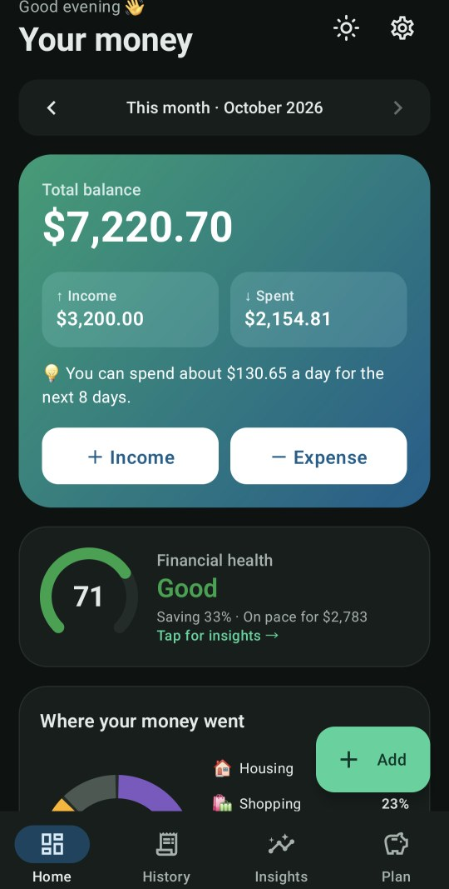
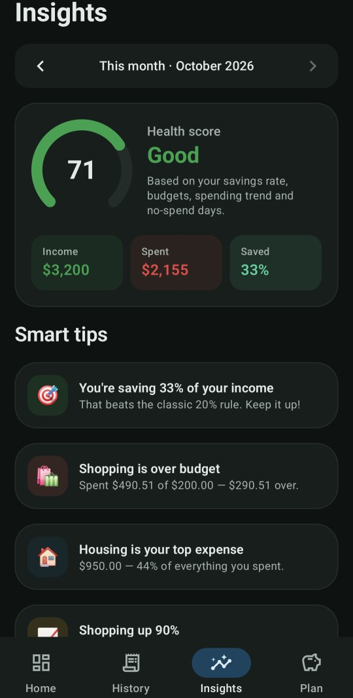
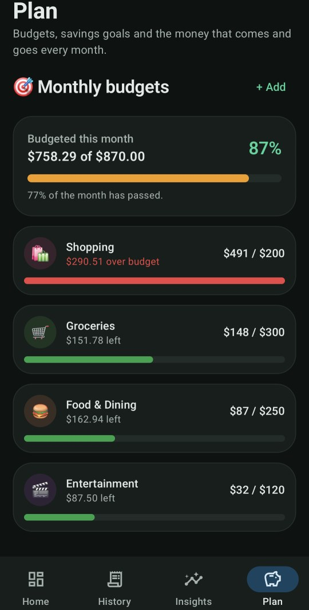

# Coinly

A private, offline personal finance app for Android. Log what comes in and goes out, and Coinly shows where your money goes, how healthy your month looks, and what to change.

**Try it:** grab the APK from the [latest release](../../releases/latest) and tap *Explore with demo data*. No account, no ads, no internet permission.

<p align="center">
  
  
  
</p>
<p align="center"><sub>Screenshots use the built-in demo data.</sub></p>

- **Home**: total balance, this month's income and spending, and a "safe to spend per day" figure for the rest of the month
- **Financial health score** (0–100) from your savings rate, budgets, spending trend and no-spend days
- **Smart tips**: overspending pace, budgets running out, categories that jumped vs the same point last month, weekend vs weekday spending, subscriptions per year, small purchases that add up…
- **Charts**: spending by category, 6-month cash flow, spending pace vs last month, and a spending calendar heatmap
- **Quick entry**: tap +, type the amount, save. The date starts on today, the category on the one you used last, and the expenses you repeat (your usual coffee, bus fare…) show up as one-tap shortcuts
- **Budgets** per category. While you type an expense you see what it does to that budget ("After this: 92% of the budget, 24.00 left"), and a notification tells you when a budget reaches 80% and when it goes over
- **Savings goals** with target dates and the monthly amount needed to reach them
- **Recurring entries** (salary, rent, subscriptions) booked automatically every month, catching up on missed months
- **Backup and restore** to a file you keep, to move to a new phone or survive a reinstall
- **History** with search and filters, **CSV export** for Excel or Google Sheets
- Light / dark / system theme, and a choice of currencies ($, €, £, DT, TND, MAD, DZD, ₹, ¥, ₪, CHF, CAD)
- **Demo data** to explore every screen before entering your own

## Privacy

No account, no ads, no tracking, and no internet permission. Your data stays in a single JSON file in the app's private storage on your phone.

## Backups

- **Settings → Back up to a file** saves everything (transactions, budgets, goals, recurring entries, settings) to one `.json` file. Save it to Google Drive, send it to yourself, or copy it to a computer. Settings shows the date of your last backup.
- **Settings → Restore from a backup** on any phone brings it all back. Coinly shows what's in the file and asks before replacing anything.
- Android's own backup also covers Coinly: if Google backup is on, your data comes back when you set up a new phone with the same account.

Uninstalling the app deletes its data, so make a backup first.

## Install

Download the APK from the [latest release](../../releases/latest), open it on your Android phone (Android 8.0 or newer) and allow installing from your browser or file manager.

## Build

You need JDK 17 and the Android SDK (platform 35).

```bash
./gradlew assembleRelease    # APK in app/build/outputs/apk/release/
./gradlew test               # quick-entry shortcuts, budget alerts and backup files
```

Built with Kotlin and Jetpack Compose.

## Project layout

```
app/src/main/java/com/coinly/app/
  data/          models, JSON storage and backups, recurring entries, stats and insights,
                 quick-entry shortcuts and budget alerts, demo data
  BudgetNotifier.kt  budget notifications
  ui/screens/    Home, History, Insights, Plan, Settings, transaction editor
  ui/components/ charts, cards and dialogs
```

## License

[MIT](LICENSE)
